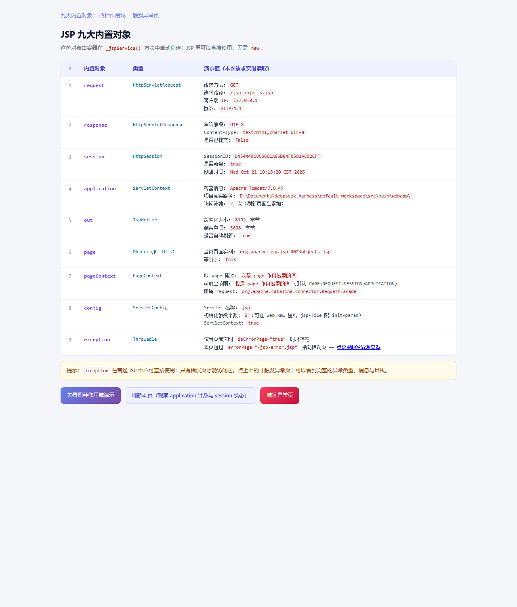
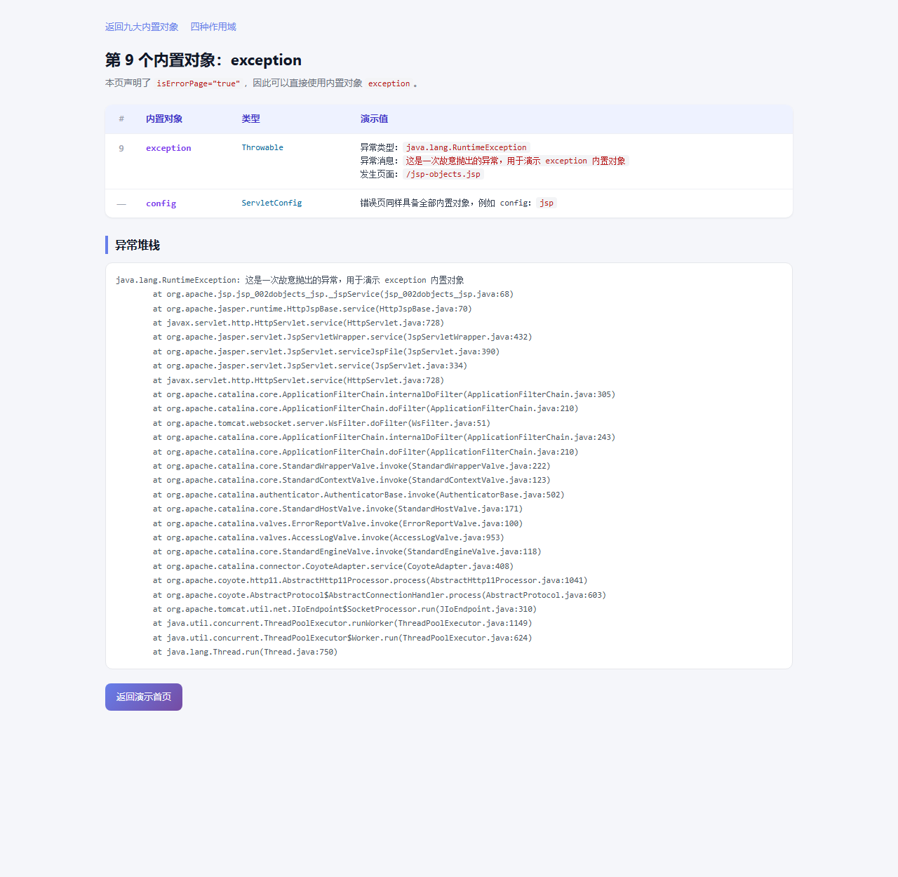
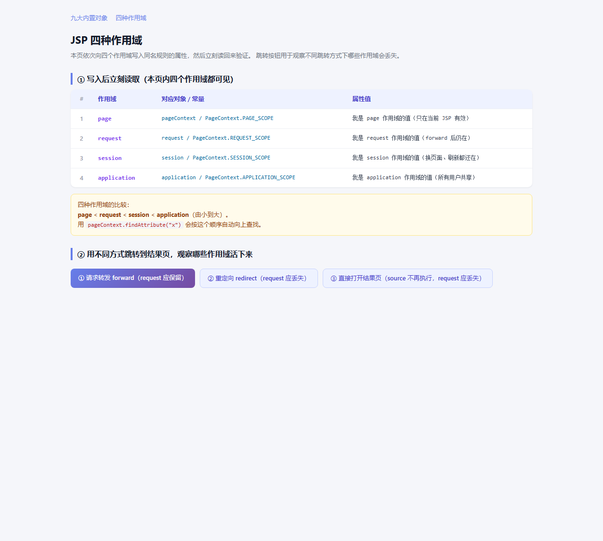
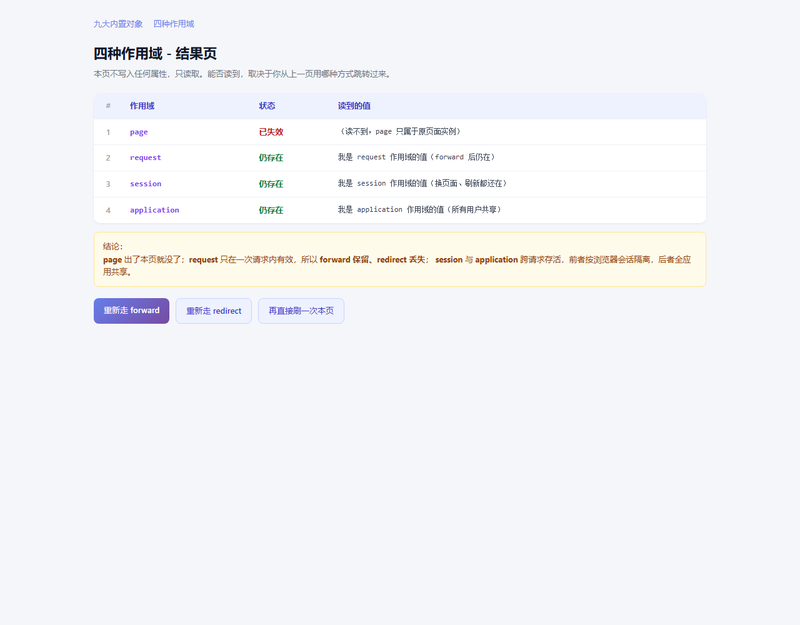
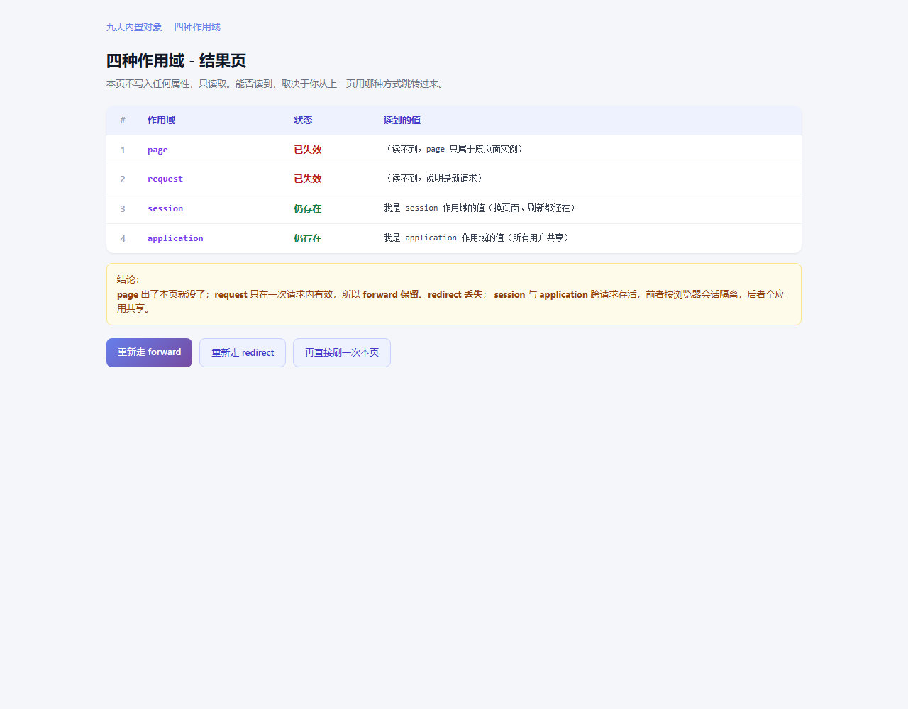

# 用户中心 · 登录 / 注册 / 忘记密码

一个可直接运行的 JavaWeb 示例项目，包含三个前端页面与三个对应的 Servlet。

## 功能清单

| 模块 | 页面 | Servlet | 说明 |
|---|---|---|---|
| 登录 | `login.jsp` | `LoginServlet` (`/login`) | 支持用户名或邮箱登录，成功后写入 Session 并跳转首页 |
| 注册 | `register.jsp` | `RegisterServlet` (`/register`) | 格式校验、用户名/邮箱查重、密码加盐哈希入库 |
| 忘记密码 | `forgot-password.jsp` | `ForgotPasswordServlet` (`/forgot-password`) | 两步式：先验证用户名+邮箱，再设置新密码 |
| 退出（配套） | — | `LogoutServlet` (`/logout`) | 销毁会话回到登录页 |
| 首页（配套） | `home.jsp` | — | 未登录自动打回登录页 |

## 运行效果

> 以下截图均为本机真实运行后截取，不是设计稿。

### JSP 九大内置对象

九个内置对象逐个取出运行时真实值：request 的客户端 IP 与 URI、session 的 SessionID、
application 的访问计数、out 的缓冲区大小等。



### 第 9 个内置对象：exception

只有声明了 `isErrorPage="true"` 的页面才能访问 `exception`，这里输出异常类型、消息与完整堆栈。



### 四种作用域

page / request / session / application 写入后立刻读回，四个都可见。



用 **forward** 跳转后：`page` 失效，`request` 仍然存在。



用 **redirect** 跳转后：`page` 与 `request` 都失效，只有 `session`、`application` 存活。



## 技术栈

- **JDK 8** + **Maven 3.9**
- **Servlet 3.0 / JSP 2.2**（`javax.servlet` 命名空间，兼容 Tomcat 7/8/9）
- **JSTL 1.2**：页面输出统一走 `<c:out>`，避免 XSS
- **MySQL 8 + JDBC**：`PreparedStatement` 防注入
- **密码存储**：PBKDF2-HMAC-SHA256，10 万次迭代 + 随机盐，形如 `pbkdf2$100000$salt$hash`

## 目录结构

```
.
├── pom.xml
├── sql/
│   └── schema.sql                  # 建库建表脚本
└── src/main/
    ├── java/com/example/auth/
    │   ├── model/User.java
    │   ├── dao/UserDao.java        # 接口
    │   ├── dao/UserDaoImpl.java    # JDBC 实现
    │   ├── util/DBUtil.java        # 连接管理
    │   ├── util/PasswordUtil.java  # 密码哈希
    │   ├── util/ValidationUtil.java
    │   └── servlet/
    │       ├── LoginServlet.java
    │       ├── RegisterServlet.java
    │       ├── ForgotPasswordServlet.java
    │       └── LogoutServlet.java
    ├── resources/db.properties     # 数据库配置（改这里的密码）
    └── webapp/
        ├── index.jsp               # 入口，跳登录
        ├── login.jsp
        ├── register.jsp
        ├── forgot-password.jsp
        ├── home.jsp
        ├── css/style.css
        └── WEB-INF/web.xml
```

## 运行步骤

### 1. 初始化数据库

```bash
mysql -u root -p < sql/schema.sql
```

### 2. 配置数据库连接

编辑 `src/main/resources/db.properties`，把 `jdbc.password` 改成你的 MySQL 密码：

```properties
jdbc.username=root
jdbc.password=你的密码
```

**更推荐的做法**：不动 `db.properties`，而是在同目录新建 `db-local.properties` 只写覆盖项：

```properties
jdbc.password=你的密码
```

`DBUtil` 会先读 `db.properties`，再用 `db-local.properties` 覆盖同名项。
这个文件已在 `.gitignore` 里，**真实密码不会被提交**，团队协作时各人本地配置互不干扰。

### 3. 启动（无需安装 Tomcat）

```bash
mvn tomcat7:run
```

然后打开 <http://localhost:8080/>。

首页 `index.jsp` 会自动跳到登录页。先在注册页创建一个账号，再用它登录。

> 用 IntelliJ IDEA 打开：直接 `Open` 本目录（选中 `pom.xml`），
> IDEA 会自动识别为 Maven 项目；在 Maven 面板双击 `tomcat7:run` 即可启动。
> 因为用的是 Maven 插件，**IDEA 社区版也能跑**，不需要 Ultimate 的 Tomcat 集成。

### 4. 打包部署到独立 Tomcat（可选）

```bash
mvn clean package
```

把 `target/user-center.war` 丢进 Tomcat 的 `webapps/` 目录即可。

## 接口/路由一览

| 方法 | 路径 | 作用 |
|---|---|---|
| GET | `/login` | 打开登录页 |
| POST | `/login` | 提交登录（参数 `account`、`password`） |
| GET | `/register` | 打开注册页 |
| POST | `/register` | 提交注册（`username`、`email`、`password`、`confirmPassword`） |
| GET | `/forgot-password` | 打开找回密码页 |
| POST | `/forgot-password` | `step=verify` 验证身份；`step=reset` 重置密码 |
| GET | `/logout` | 退出登录 |

## 安全设计说明

1. **密码不落明文**：PBKDF2 + 每用户独立随机盐，校验用常量时间比较。
2. **SQL 注入**：全部使用 `PreparedStatement` 参数绑定。
3. **XSS**：JSP 回显统一 `<c:out>` 转义。
4. **账号枚举**：登录失败统一提示「用户名或密码错误」，不区分账号是否存在。
5. **会话固定**：登录成功后 `invalidate()` 旧会话再新建。
6. **越权改密**：重置密码第二步会再次校验用户名+邮箱，防止构造请求改他人密码。

## 开发约定

- 所有 Servlet 用 `@WebServlet` 注解注册，`web.xml` 只放全局配置。
- 包结构按 `model / dao / util / servlet` 分层，Servlet 不写 SQL。
- 提交前执行 `mvn clean package` 确保能编译通过。
